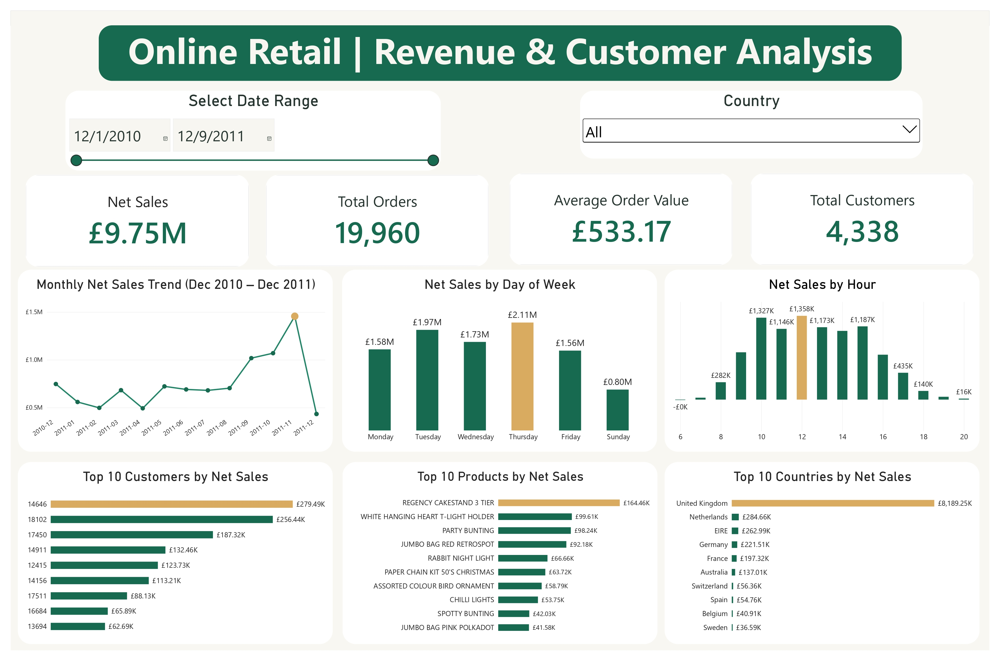

# Online Retail Revenue & Customer Analysis

### An End-to-End Data Analytics Project Using MySQL & Power BI

## Project Overview

This project analyzes transaction data from a UK-based online retailer to evaluate sales performance, customer purchasing patterns, product revenue contributions, and geographic sales distribution.

Using MySQL for data cleaning and preparation and Power BI for interactive visualization, the project transforms raw transaction records into meaningful business insights. The analysis aims to identify revenue patterns and provide data-driven recommendations to support business decision-making.

## Business Objectives

The project focuses on four main objectives:

1. **Evaluate Sales Performance** — Measure net sales, total orders, and average order value to assess overall retail performance.
2. **Identify Key Revenue Drivers** — Determine which products, customers, and countries contribute the most to revenue.
3. **Analyze Sales Patterns** — Examine monthly, daily, and hourly sales trends to identify purchasing patterns.
4. **Develop Business Recommendations** — Translate analytical findings into actionable recommendations for business improvement.

## Dataset Information

The dataset was obtained from the **UCI Machine Learning Repository** and contains transaction records from a UK-based online retailer specializing in unique gifts.

| Attribute | Description |
|---|---|
| Dataset | Online Retail |
| Source | [UCI Machine Learning Repository](https://archive.ics.uci.edu/dataset/352/online+retail) |
| Industry | E-commerce / Retail |
| Original Records | 541,909 transaction-line records |
| Original Variables | 8 columns |
| Transaction Period | December 1, 2010 – December 9, 2011 |
| Currency | British Pound Sterling (GBP) |

The dataset includes invoice identifiers, product information, quantities, transaction dates, unit prices, customer identifiers, and countries. Each row represents an item within a transaction rather than a unique order.

## Tools & Technologies

| Tool | Purpose |
|---|---|
| **MySQL** | Data import, validation, cleaning, transformation, and SQL-based analysis |
| **MySQL Workbench** | Database management and SQL query execution |
| **Power BI** | Data modeling, interactive dashboard development, and business intelligence reporting |
| **DAX** | Calculating KPIs and analytical measures, including net sales, total orders, and average order value |
| **Microsoft PowerPoint** | Presenting analytical findings, business insights, and strategic recommendations |
| **GitHub** | Project documentation, version control, and portfolio publication |

## Data Cleaning & Preparation

The original dataset contained **541,909 transaction-line records**. Data preparation was performed in MySQL to improve data quality and establish a reliable foundation for revenue analysis.

The cleaning process included:

1. **Data Validation:** Examined missing values, duplicate records, transaction quantities, unit prices, and invoice identifiers.
2. **Data Backup:** Created a backup of the original dataset before performing cleaning operations.
3. **Duplicate Removal:** Removed 5,268 exact duplicate records, reducing the dataset to 536,641 rows.
4. **Missing Product Descriptions:** Excluded 1,454 records with blank product descriptions, resulting in 535,187 rows.
5. **Transaction Classification:** Distinguished completed sales from cancellations using invoice identifiers and transaction quantities.
6. **Revenue Calculation:** Calculated transaction-level revenue using `Quantity × UnitPrice`, accounting for negative cancellation values.
7. **Reporting View Creation:** Created the `vw_sales_analysis` SQL view containing 534,129 transaction-line records for Power BI reporting.

**Final reporting dataset:** 534,129 transaction-line records, including 524,878 paid-sales rows and 9,251 cancellation rows.

Missing CustomerID values were retained to avoid unnecessarily excluding valid sales transactions. Records with zero-value transactions were excluded from revenue reporting.

## Power BI Dashboard

The interactive Power BI dashboard provides an overview of retail sales performance, customer contributions, product revenue, and purchasing trends.

### Dashboard Preview



### Key Performance Indicators (KPIs)

| KPI | Value |
|---|---:|
| **Net Sales** | **£9.75M** |
| **Total Orders** | **19,960** |
| **Average Order Value (AOV)** | **£533.17** |
| **Total Customers** | **4,338** |

The dashboard includes six analytical visualizations covering monthly revenue trends, sales by weekday and hour, top customers, top products, and geographic sales distribution. Interactive date and country slicers allow users to explore different segments of the data.

[View Power BI Dashboard File](dashboard/online_retail.pbix)

## Key Findings

1. **Sales Performance:** Net sales reached approximately **£9.75 million**. November 2011 recorded the highest monthly revenue, indicating strong sales activity toward the end of the year. December 2011 contains only nine days of data and should not be interpreted as a full-month decline.

2. **Purchasing Patterns:** Thursday generated the highest net sales at approximately **£2.11 million**. Hourly revenue peaked around **12 PM**, suggesting stronger purchasing activity during midday.

3. **Customer Contributions:** Customer **14646** generated the highest revenue at approximately **£279.49K**, followed by customers **18102** and **17450**. These findings highlight the importance of high-value customers to overall revenue.

4. **Product Performance:** **REGENCY CAKESTAND 3 TIER** was the highest-revenue product, contributing approximately **£164.46K**. Other leading products included **WHITE HANGING HEART T-LIGHT HOLDER** and **PARTY BUNTING**.

5. **Geographic Distribution:** The **United Kingdom** accounted for approximately **£8.19 million**, representing around **84%** of total net sales. The Netherlands, Ireland (EIRE), and Germany were among the leading international markets.

## Business Recommendations

Based on the analytical findings, the following strategies are recommended:

1. **Optimize Seasonal Sales Planning:** Prepare inventory, promotional campaigns, and operational resources ahead of high-demand periods, particularly the year-end shopping season.

2. **Improve Marketing Campaign Timing:** Schedule targeted promotions around high-performing purchasing periods, particularly Thursdays and midday hours, while testing opportunities to improve sales during lower-performing periods.

3. **Strengthen Customer Retention:** Develop personalized loyalty programs and targeted engagement strategies for high-value customers to encourage repeat purchases and maintain long-term revenue contributions.

4. **Prioritize High-Performing Products:** Improve inventory planning and product promotion strategies for leading revenue-generating items while monitoring demand to reduce stockouts and excess inventory.

5. **Explore International Market Opportunities:** Maintain a strong focus on the UK market while evaluating growth opportunities in the Netherlands, Ireland, and Germany through localized marketing and distribution strategies.

These recommendations are based on historical transaction patterns and should be validated through further analysis and business testing before implementation.

## Repository Structure

```text
online-retail-sales-analysis/
├── README.md
├── sql/
│   ├── README.md
│   └── online_retail_analysis.sql
├── dashboard/
│   ├── README.md
│   ├── online_retail_dashboard.pbix
│   └── dashboard_preview.png
└── presentation/
    ├── README.md
    └── online_retail_presentation.pdf
```

## Project Files

- **[SQL Analysis Script](sql/online_retail_analysis.sql)** — MySQL queries for data validation, cleaning, transformation, and reporting.
- **[Power BI Dashboard](dashboard/online_retail.pbix)** — Interactive dashboard containing KPIs and analytical visualizations.
- **[Dashboard Preview](dashboard/online_retail.jpg)** — Screenshot of the completed Power BI dashboard.
- **[Project Presentation](presentation/online_retail_presentation.pdf)** — Full project documentation, findings, interpretations, and business recommendations.
